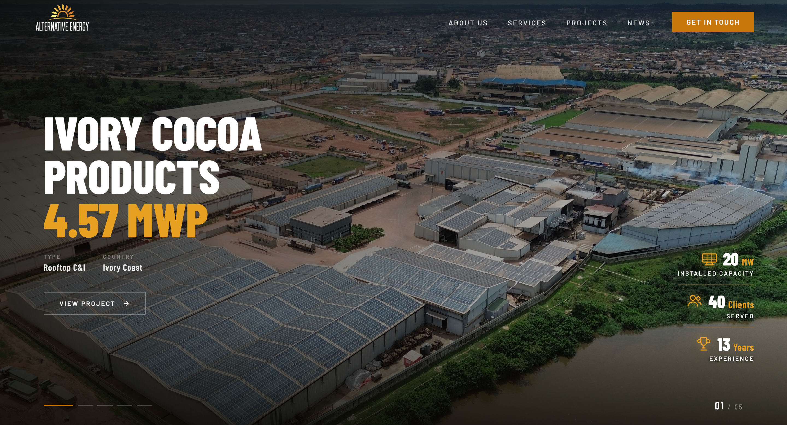
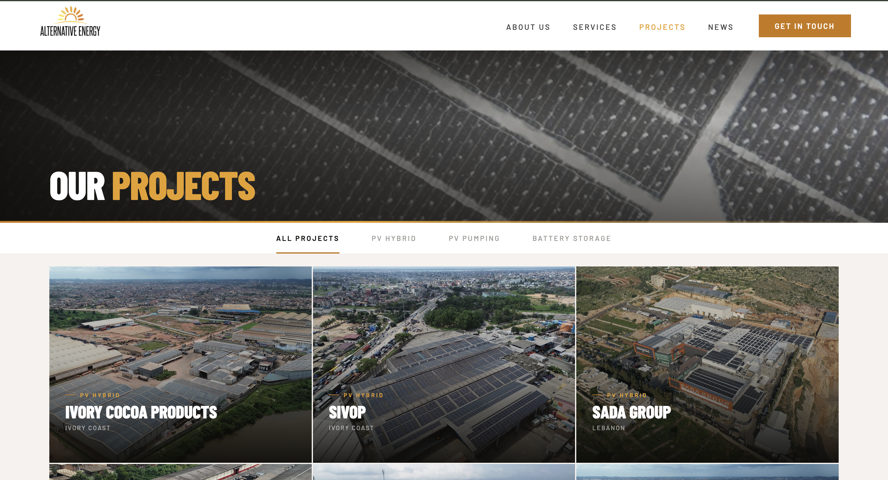
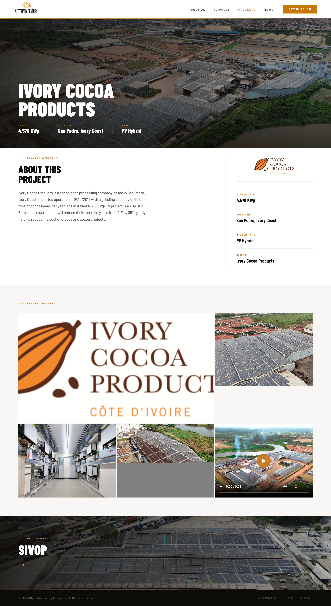

# ☀️ AEMENA – Corporate Website Frontend Optimization

Improved and refined an existing corporate website through Figma-based frontend implementation, responsive UI development, visual consistency, and production asset recovery.

## 📌 Overview

AEMENA is a corporate website showcasing the company's services, projects, and work, with a strong focus on solar energy projects and related media.

My contribution focused primarily on improving the existing frontend experience — translating Figma designs into responsive interfaces, refining layouts and reusable components, fixing frontend issues, and integrating existing application functionality.

I also supported project preservation by recovering and organizing existing website media assets from AWS S3 for use in the restored application.

## 🎯 Objectives

- Implement and refine UI based on Figma designs
- Improve overall visual consistency
- Strengthen responsive behavior across devices
- Fix existing frontend layout and styling issues
- Build and improve reusable UI components
- Preserve important project media assets
- Prepare the frontend and recovered assets for continued restoration

## 🛠️ My Contributions

### 🎨 UI/UX & Frontend Development

- Implemented and refined interfaces based on Figma designs
- Improved existing layouts, styling, and visual consistency
- Built and refined reusable frontend components
- Improved responsive behavior across desktop, tablet, and mobile
- Fixed frontend UI and layout issues
- Integrated existing application functionality into updated interfaces

### 📱 Responsive Optimization

- Improved mobile and tablet layouts
- Refined spacing, sizing, and component behavior across breakpoints
- Fixed responsive presentation issues
- Ensured key website sections remained consistent across screen sizes

### 📦 Asset Recovery & Preservation

- Recovered existing website media assets from AWS S3
- Preserved solar project images and videos
- Maintained the existing project-based folder organization
- Created local backups of recovered assets
- Prepared recovered media for reuse in the restored website

## ⚙️ Tech Stack

- **Framework:** Next.js
- **Frontend:** React
- **Language:** JavaScript
- **Styling:** Tailwind CSS
- **Design:** Figma
- **Asset Storage:** AWS S3
- **Version Control:** Git / GitHub

## ✨ Key Highlights

- Figma-to-frontend implementation
- Responsive corporate website UI
- Reusable frontend components
- Mobile and tablet optimization
- Frontend bug fixes and refinements
- Solar project media presentation
- Existing functionality integration
- AWS S3 media asset recovery

## 📈 Outcome

Improved the AEMENA frontend with a more polished, responsive, and consistent user experience while preserving important project media assets required for continued website restoration.

The work focused on strengthening the existing frontend and safeguarding company project content without claiming ownership of backend infrastructure or server recovery outside my scope.

## 🎥 Project Walkthrough

Watch the project walkthrough to explore the frontend improvements, responsive experience, and key website sections.

▶️ **[Watch AEMENA Project Walkthrough on YouTube](YOUR_YOUTUBE_VIDEO_LINK)**

## 🖼️ Preview

## 🤝 Notes

This project was completed as part of a client-based collaboration.

My contribution focused on frontend/UI development, responsive optimization, existing functionality integration, and media asset recovery. Backend infrastructure, database recovery, and server migration were outside my development scope.

## 👨‍💻 Developer

**Shahinur Alam Bhuiyan**  
Frontend Developer (React / Next.js / TypeScript)

- 💼 Upwork: https://www.upwork.com/freelancers/~01bf24b7725d70b752
- 🌐 Portfolio: https://shahinuralambhuiyan.vercel.app
- 📧 Mail: shahinur.alam.bhuiyan01@gmail.com

## 🔒 Showcase Notice

This repository is intended for portfolio and demonstration purposes only.

Production source code, credentials, private infrastructure details, and client-confidential materials are not included.

## 📄 License

This repository is not licensed for redistribution or reuse.  
All content is provided for demonstration and portfolio purposes only.

> © 2026 – AEMENA  
> _Frontend development & optimization by Shahinur Alam Bhuiyan_
